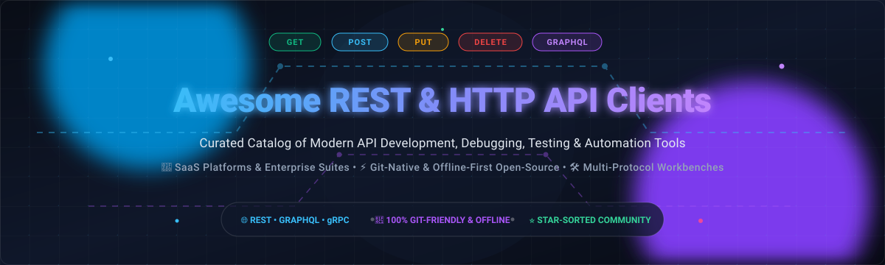

# Awesome-Rest-HTTP-API-Client

 

  

  <strong>🚀 A curated directory of top REST &amp; HTTP API clients, testing suites, GUI workbenches, and CLI automation tools.</strong> 
  Discover top-tier SaaS API ecosystems and battle-tested open-source clients for REST, GraphQL, gRPC, WebSockets, and SSE.

  <a href="#-sector-overview--market-dynamics">Sector Overview</a> •
  <a href="#-saas--hosted-platforms">SaaS Platforms</a> •
  <a href="#-open-source-software">Open-Source Clients</a> •
  <a href="#-feature-matrix--comparison-at-a-glance">Feature Matrix</a> •
  <a href="#-star-history">Star History</a> •
  <a href="#-support">Support</a> •
  <a href="#-contributing">Contributing</a>

---

## 📋 Table of Contents

- [🌐 Sector Overview & Market Dynamics](#-sector-overview--market-dynamics)
- [🏢 SaaS / Hosted Platforms](#-saas--hosted-platforms)
- [💻 Open-Source Software](#-open-source-software)
  - [1. Hoppscotch](#1-hoppscotch)
  - [2. Bruno](#2-bruno)
  - [3. Insomnia](#3-insomnia)
  - [4. HTTPie CLI](#4-httpie-cli)
  - [5. Yaak](#5-yaak)
  - [6. Scalar API Client](#6-scalar-api-client)
  - [7. REST Client for VS Code](#7-rest-client-for-vs-code)
  - [8. rest-client (Ruby)](#8-rest-client-ruby)
  - [9. API Dash](#9-api-dash)
  - [10. Restfox](#10-restfox)
  - [11. Firecamp](#11-firecamp)
  - [12. Milkman](#12-milkman)
  - [13. RESTer](#13-rester)
- [📊 Feature Matrix & Comparison at a Glance](#-feature-matrix--comparison-at-a-glance)
- [📈 Star History](#-star-history)
- [💖 Support](#-support)
- [🤝 Contributing](#-contributing)
- [📄 License](#-license)

---

## 🌐 Sector Overview & Market Dynamics

The global API management and testing tools market is estimated at approximately **$5.1 billion to $6.8 billion** and is projected to expand at a compound annual growth rate (CAGR) exceeding **25%** through 2030, driven by microservices architectures, AI-agent integrations, and cloud-native workflows. 

Market dynamics exhibit a **moderately concentrated, bifurcated structure**: enterprise cloud workspaces remain dominated by category leaders like Postman and Kong, yet increasing privacy requirements and vendor lock-in pushback have triggered significant **open-source fragmentation**, sparking rapid adoption of Git-native, offline-first, and self-hosted developer tools.

---

## 🏢 SaaS / Hosted Platforms

Below is a detailed breakdown of leading commercial and hosted REST/HTTP API client platforms, sorted descending by company scale (market valuation / parent company revenue).

| Platform | Company Scale (Valuation / Revenue) | Starting Paid Pricing | Free Tier / Trial Limits | Primary Protocols & Features |
| :--- | :--- | :--- | :--- | :--- |
| **[Fiddler](https://www.telerik.com/fiddler)** | **$3.78B Market Cap / ~$700M Rev** *(Progress Software, NASDAQ: PRGS)* | **$12 / user / month** *(Fiddler Everywhere, billed annually at $144/yr)* | **10-day full-featured free trial**; Free tier limited to legacy classic Windows desktop viewer with local inspection | Deep HTTP/HTTPS web debugging proxy, traffic capture, API payload replay, TLS inspection, mock responses |
| **[Postman API Client](https://www.postman.com/)** | **$5.60B Valuation** *(Valued at $5.6B in Series D round)* | **$14 / user / month** *(Basic tier, billed annually at $168/user/yr; or $19 billed monthly)* | **Free forever plan**: Up to 3 team members, 25 collection runner runs/mo, 1,000 mock server calls/mo, and 1,000 cloud monitor runs/mo | Cloud & desktop API client workspaces, automated testing, mock servers, documentation publishing, native Git sync |
| **[Insomnia (Kong)](https://insomnia.rest/)** | **$2.00B Valuation** *(Kong Inc. Series E valuation)* | **$12 / user / month** *(Pro tier, billed annually)* | **Free forever plan**: 1 cloud project, up to 3 collaborators per Git Sync project, unlimited local storage, 1,000 mock server requests/mo | REST, GraphQL (autocomplete & introspection), gRPC, WebSockets, SSE, end-to-end encryption, Git sync |
| **[Paw (RapidAPI)](https://paw.cloud/)** | **$1.00B Valuation** *(RapidAPI Unicorn Series D valuation)* | **$49.99 one-time license** *(Individual Mac standalone; or via RapidAPI Pro from $10/user/mo)* | **14-day unrestricted free trial** on macOS standalone version with full export/import capabilities | Native macOS client, visual request composer, dynamic environments, code generation in 15+ languages, GraphQL/REST |
| **[Thunder Client](https://www.thunderclient.com/)** | **Bootstrapped / ~$2M - $5M ARR** *(Independent specialized developer tool)* | **$3 / user / month** *(Starter tier, billed annually; or $3.50 monthly)* | **Free forever plan**: Unlimited local requests, unlimited personal collections, environment variables for single user | Embedded VS Code & JetBrains extension, zero desktop window switching, local Git-friendly JSON files, script runners |

---

## 💻 Open-Source Software

Curated open-source REST & HTTP API clients, ordered descending by community popularity (**GitHub Stars_Counts** ⭐).

### 1. Hoppscotch

- **Repository:** [hoppscotch/hoppscotch](https://github.com/hoppscotch/hoppscotch) 🌟
- **Stack:** Vue.js, TypeScript, PWA, Node.js | **License:** MIT
- **Description:** A lightweight, web-based and desktop API development ecosystem that serves as an open-source alternative to Postman. It supports real-time communication protocols out of the box.
- **Key Features:** Multi-protocol support (REST, GraphQL, WebSockets, Server-Sent Events, MQTT, Socket.IO), browser extension proxying, team collaboration, self-hostable Docker deployments, and keyboard-first UI navigation.

### 2. Bruno

- **Repository:** [usebruno/bruno](https://github.com/usebruno/bruno) 🌟
- **Stack:** JavaScript, Electron, Node.js | **License:** MIT
- **Description:** An offline-first, Git-friendly desktop API client that stores collections directly in your repo using plain text files (`.bru` / OpenCollection format) without vendor cloud lock-in.
- **Key Features:** True Git synchronization via normal developer branches and PRs, 100% offline functionality, zero cloud sync or external servers, scriptable test assertions, and cross-platform desktop installers.

### 3. Insomnia

- **Repository:** [Kong/insomnia](https://github.com/Kong/insomnia) 🌟
- **Stack:** Electron, React, TypeScript | **License:** Apache-2.0
- **Description:** A mature, open-source desktop REST, GraphQL, gRPC, and WebSocket testing suite designed by Kong with visual request chaining and schema exploration.
- **Key Features:** Industry-leading GraphQL schema introspection and autocompletion, gRPC protobuf exploration, end-to-end encrypted project sync, plugins ecosystem, and automated unit testing.

### 4. HTTPie CLI

- **Repository:** [httpie/cli](https://github.com/httpie/cli) 🌟
- **Stack:** Python | **License:** BSD-3-Clause
- **Description:** A modern, user-friendly command-line HTTP client engineered for the API era, providing intuitive syntax, JSON formatting, syntax highlighting, and session persistence.
- **Key Features:** Expressive natural syntax (`http POST example.com hello=world`), native JSON parsing, formatted terminal colorization, persistent sessions, authentication plugins, and stream handling.

### 5. Yaak

- **Repository:** [mountain-loop/yaak](https://github.com/mountain-loop/yaak) 🌟
- **Stack:** Rust, Tauri, React, TypeScript | **License:** MIT (Source Available)
- **Description:** An ultra-fast, lightweight desktop API client built with Rust and Tauri by the original creator of Insomnia, engineered for privacy, speed, and minimal memory footprint.
- **Key Features:** Native rendering without Electron overhead, support for REST, GraphQL, gRPC, and WebSockets, zero telemetry or tracking, automatic dark mode, and local JSON database storage.

### 6. Scalar API Client

- **Repository:** [scalar/scalar](https://github.com/scalar/scalar) 🌟
- **Stack:** Vue.js, TypeScript, OpenAPI | **License:** MIT
- **Description:** An offline-first, modern REST API testing client tightly integrated with OpenAPI/Swagger specifications, interactive documentation references, and mock servers.
- **Key Features:** First-class OpenAPI 3.0 & 3.1 compatibility, automatic client generation in dozens of languages, offline browser and desktop apps, Postman and cURL importing.

### 7. REST Client for VS Code

- **Repository:** [Huachao/vscode-restclient](https://github.com/Huachao/vscode-restclient) 🌟
- **Stack:** TypeScript, VS Code API | **License:** MIT
- **Description:** Popular Visual Studio Code extension that allows developers to write, invoke, and inspect HTTP requests directly within plain `.http` or `.rest` files inside their editor.
- **Key Features:** Version-controllable RFC 7230 HTTP request scripts, multi-environment variable support, response preview with syntax highlighting, cURL code generation, and GraphQL support.

### 8. rest-client (Ruby)

- **Repository:** [rest-client/rest-client](https://github.com/rest-client/rest-client) 🌟
- **Stack:** Ruby | **License:** MIT
- **Description:** A simple, reliable HTTP and REST client library for Ruby, inspired by microframework syntax for executing API requests programmatically.
- **Key Features:** Clean DSL for GET, POST, PUT, DELETE operations, automatic cookie handling, payload streaming, raw and JSON responses, and simple CLI utility executable.

### 9. API Dash

- **Repository:** [foss42/apidash](https://github.com/foss42/apidash) 🌟
- **Stack:** Flutter, Dart | **License:** Apache-2.0
- **Description:** A beautiful, lightweight, cross-platform API client built with Flutter supporting macOS, Windows, Linux, Android, and iOS for frictionless testing on mobile and desktop.
- **Key Features:** AI-assisted request generation, clean Flutter UI, multi-language code generator (Dart, Python, Kotlin, cURL, JS), GraphQL queries, and zero background analytics.

### 10. Restfox

- **Repository:** [flawiddsouza/Restfox](https://github.com/flawiddsouza/Restfox) 🌟
- **Stack:** Vue.js, Electron, WebExtensions | **License:** MIT
- **Description:** An offline-first, minimalistic HTTP and WebSocket testing client available as a web app, desktop application, and browser extension.
- **Key Features:** Simple Postman-like interface with zero signup required, browser storage or local folder persistence, WebSocket inspection, and Postman collection import/export.

### 11. Firecamp

- **Repository:** [firecamp-dev/firecamp](https://github.com/firecamp-dev/firecamp) 🌟
- **Stack:** TypeScript, Electron, Next.js | **License:** Open Source
- **Description:** A developer-first open-source API development workbench built as a comprehensive multi-protocol alternative to Postman and Insomnia.
- **Key Features:** Simultaneous multi-protocol support for REST, GraphQL, WebSocket, and Socket.IO, visual request composer, team sync, and modular testing runners.

### 12. Milkman

- **Repository:** [warmuuh/milkman](https://github.com/warmuuh/milkman) 🌟
- **Stack:** Java, JavaFX | **License:** MIT
- **Description:** An extensible request/response workbench designed for fast startup and low resource consumption, powered by a modular plugin architecture.
- **Key Features:** Fast JavaFX native UI, plugin support for HTTP, SQL, Cassandra, gRPC, and GraphQL, sync via Git repositories, and low memory consumption.

### 13. RESTer

- **Repository:** [frigus02/RESTer](https://github.com/frigus02/RESTer) 🌟
- **Stack:** JavaScript, WebExtensions | **License:** MIT
- **Description:** A lightweight, privacy-focused browser extension for Firefox and Chrome that lets developers test REST APIs directly inside browser tabs.
- **Key Features:** Local browser storage, OAuth 2.0 and Basic Auth support, environment parameter replacement, no remote server relay, and instant response viewing.

---

## 📊 Feature Matrix & Comparison at a Glance

| Client | Type | Community GitHub_Stars | Supported Protocols | Offline-First | Git-Native | Best Use Case |
| :--- | :--- | :--- | :--- | :---: | :---: | :--- |
| **Hoppscotch** | Open-Source | ~80.8k ⭐ | REST, GraphQL, WS, SSE, MQTT | ⚠️ Partial | ❌ Cloud/Self-Host | Multi-protocol browser & web app testing |
| **Bruno** | Open-Source | ~48.4k ⭐ | REST, GraphQL, gRPC, WS, SOAP | ✅ Yes | ✅ 100% Files | Git-versioned collections & offline safety |
| **Insomnia** | Open-Source Core | ~40.1k ⭐ | REST, GraphQL, gRPC, WS, SSE | ⚠️ Partial | ✅ Team Git Sync | GraphQL schemas & enterprise API design |
| **HTTPie CLI** | Open-Source | ~38.7k ⭐ | HTTP/REST | ✅ Yes | ❌ Scriptable | Rapid terminal debugging & CLI scripts |
| **Yaak** | Open-Source | ~19.5k ⭐ | REST, GraphQL, gRPC, WS, SSE | ✅ Yes | ✅ Local DB | Fast, privacy-focused desktop workbench |
| **Scalar** | Open-Source | ~16.4k ⭐ | REST / OpenAPI | ✅ Yes | ⚠️ Spec-driven | OpenAPI 3.x-native documentation & testing |
| **REST Client (VSCode)** | Open-Source | ~6.1k ⭐ | HTTP, REST, GraphQL | ✅ Yes | ✅ Plain `.http` | IDE-integrated in-repo request execution |
| **rest-client** | Open-Source | ~5.2k ⭐ | HTTP/REST | ✅ Yes | ❌ Library | Ruby programmatic scripts & automated tests |
| **API Dash** | Open-Source | ~3.0k ⭐ | REST, GraphQL | ✅ Yes | ❌ Local export | Cross-platform desktop & mobile testing |
| **Restfox** | Open-Source | ~2.8k ⭐ | REST, WebSockets | ✅ Yes | ⚠️ Local folder | Quick no-login browser & desktop client |
| **Firecamp** | Open-Source | ~2.6k ⭐ | REST, GraphQL, WS, Socket.IO | ⚠️ Partial | ⚠️ Cloud/Local | Multi-protocol collaboration workbench |
| **Milkman** | Open-Source | ~1.4k ⭐ | HTTP, gRPC, SQL, GraphQL | ✅ Yes | ✅ Git plugin | Plugin-extensible developer workbench |
| **RESTer** | Open-Source | ~390 ⭐ | HTTP/REST | ✅ Yes | ❌ Extension | Lightweight in-browser ad-hoc debugging |
| **Postman** | SaaS / Commercial | N/A (Proprietary) | REST, GraphQL, gRPC, WS | ⚠️ Cloud-first | ✅ Cloud & Git | Enterprise teams needing full API lifecycle |
| **Fiddler Everywhere** | SaaS / Commercial | N/A (Proprietary) | HTTP, HTTPS, WebSockets | ✅ Local Proxy | ❌ Proprietary | Network traffic inspection & TLS debugging |
| **Paw (RapidAPI)** | Commercial | N/A (Proprietary) | REST, GraphQL, WebSockets | ✅ Yes | ⚠️ RapidAPI Sync | Native macOS design & visual composing |
| **Thunder Client** | Freemium Plugin | N/A (Proprietary) | REST (Paid: WS, gRPC) | ✅ Local | ⚠️ Paid Feature | Embedded VS Code lightweight testing |

---

## 📈 Star History

---

## 💖 Support

Thank you for exploring this curated directory! If you find this repository valuable for your daily API development, testing, and debugging workflows, please consider supporting the project:

- ⭐ **Star this repository** to help others discover it across GitHub.
- 🍴 **Fork and contribute** by adding new tools or updating documentation.
- 📢 **Share the project** with your team, fellow developers, or on social media.
- ☕ **Buy me a coffee / Sponsor**: If you'd like to support ongoing maintenance and new developer resources, consider sponsoring via the [GitHub Sponsors Dashboard](https://github.com/sponsors/ishandutta2007).

  

---

## 🤝 Contributing

Contributions, new tools, and updates are very welcome! 🎉

1. Fork this repository.
2. Add your tool to the appropriate section maintaining chronological or star-count sorting.
3. Ensure the project is actively maintained and provides a clear description, GitHub link, stack, and license.
4. Submit a Pull Request with a clear title and description.

---

## 📄 License

This collection is licensed under [Creative Commons Zero v1.0 Universal](LICENSE) (Public Domain Dedication). Each individual project listed retains its respective open-source or commercial license.

  Made with ❤️ for the global developer community. If you found this list helpful, please give it a ⭐!

